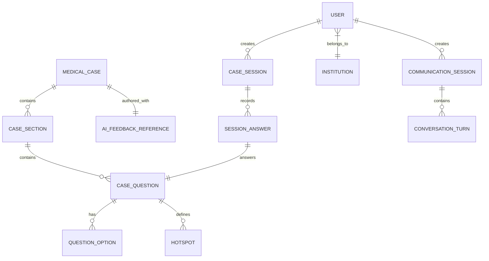

# Báo cáo Khảo sát Tham khảo: CyberPatient (Clean-room Reconnaissance)

> **Cảnh báo Clean-room**: Báo cáo này chỉ phục vụ mục đích phân tích UX, luồng nghiệp vụ và cấu trúc tính năng tham khảo. Toàn bộ mã nguồn, nội dung ca bệnh, tài sản hình ảnh/3D/âm thanh và nhãn hiệu của dự án AI Virtual Patient được tự thiết kế độc lập 100%, không sao chép từ CyberPatient.
> 
> **Phương pháp khảo sát**: Phân tích chỉ đọc bằng REA (Reverse Engineer Anything) qua Chrome DevTools Protocol (CDP) và phân tích tĩnh client-side asset bundle công khai (`index-3e6fe0e0.js` và 65 chunks) tại `https://learn.cyberpatient.ca/`. Không can thiệp, không đăng nhập trái phép, không vượt paywall.

---

## 1. Sitemap & Danh mục Trang (Public & Authenticated Routes)

Dựa trên router client-side và quan sát CDP:

| Route / Đường dẫn | Trạng thái truy cập | Mục đích & Mô tả giao diện |
| :--- | :--- | :--- |
| `/` | Công khai | Trang đích (Landing) chuyển hướng tự động vào đăng nhập hoặc màn hình chính. |
| `/login`, `/login/verify` | Công khai | Đăng nhập tài khoản & xác thực 2 lớp (2FA qua mã bảo mật email). |
| `/register` | Công khai | Đăng ký tài khoản người học cá nhân (hỗ trợ gắn mã tiếp thị affiliate). |
| `/recover`, `/resetPassword/:token` | Công khai | Quy trình khôi phục mật khẩu qua email xác nhận. |
| `/student/join/:slug` | Công khai (Cần slug) | Cổng tham gia lớp học của sinh viên thông qua mã định danh trường đại học y. |
| `/activate-license/:licenseId` | Công khai (Cần token) | Kích hoạt mã bản quyền khóa học được cấp bởi cơ sở đào tạo. |
| `/choose-plan`, `/pricing` | Công khai | Bảng giá và gói đăng ký dành cho người học cá nhân. |
| `/complete-purchase` | Công khai | Màn hình hoàn tất thanh toán (sau khi trả qua Stripe Checkout). |
| `/home` | `[KHÔNG TRUY CẬP ĐƯỢC]` (Cần đăng nhập) | Dashboard tổng quan: số ca đã làm, chuỗi ngày học (streak), điểm kinh nghiệm (XP), ca bệnh gần nhất. |
| `/library` | `[KHÔNG TRUY CẬP ĐƯỢC]` (Cần đăng nhập) | Thư viện toàn bộ các ca bệnh lâm sàng phân loại theo chuyên khoa. |
| `/journeys` | `[KHÔNG TRUY CẬP ĐƯỢC]` (Cần đăng nhập) | Lộ trình học tập có cấu trúc (Tiêu hóa, Hô hấp, Tim mạch, Nhi khoa, v.v.). |
| `/simulation/case/:caseId` | `[KHÔNG TRUY CẬP ĐƯỢC]` (Cần đăng nhập) | Màn hình chuẩn bị ca mô phỏng lâm sàng. |
| `/simulation/:sessionId` | `[KHÔNG TRUY CẬP ĐƯỢC]` (Cần đăng nhập) | Không gian làm việc mô phỏng khám bệnh ảo (Clinical Workspace). |
| `/simulation/:sessionId/feedback` | `[KHÔNG TRUY CẬP ĐƯỢC]` (Cần đăng nhập) | Báo cáo đánh giá và phản hồi chi tiết sau ca mô phỏng. |
| `/communication/start/:id` | `[KHÔNG TRUY CẬP ĐƯỢC]` (Cần đăng nhập) | Màn hình kiểm tra thiết bị micro/audio trước khi trò chuyện với bệnh nhân ảo. |
| `/communication/:sessionId` | `[KHÔNG TRUY CẬP ĐƯỢC]` (Cần đăng nhập) | Phòng hội thoại tương tác giọng nói thời gian thực với AI bệnh nhân ảo. |
| `/emergency-simulation/` | `[KHÔNG TRUY CẬP ĐƯỢC]` (Cần đăng nhập) | Không gian thực hành cấp cứu khẩn cấp (CPR, đặt nội khí quản, sốc điện). |
| `/faculty-management` | `[KHÔNG TRUY CẬP ĐƯỢC]` (Quyền Giảng viên/Admin) | Quản lý giảng viên và phân công ca học. |
| `/student-management` | `[KHÔNG TRUY CẬP ĐƯỢC]` (Quyền Giảng viên/Admin) | Quản lý sinh viên, cấp phát license và theo dõi tiến độ đào tạo. |

---

## 2. User Flows Chi tiết

### 2.1. Luồng Khám bệnh Lâm sàng Ảo (Clinical Simulation Flow)
1. **Bước 1 (Chọn ca):** Người học duyệt Thư viện `/library`, xem tóm tắt ca bệnh (tuổi, giới tính, lý do đến khám) và chọn cấp độ thử thách.
2. **Bước 2 (Khởi tạo phiên):** Client gửi `POST /api/v2/simulation/case-sessions/new` với timezone của trình duyệt để khởi tạo phiên làm bài `sessionId`.
3. **Bước 3 (Khám bệnh theo 5 Sections):**
   * *Section 1: Initial Assessment (Đánh giá ban đầu):* Hỏi bệnh sử (History Taking) và Khám thực thể (Physical Exam). Khám thực thể sử dụng tương tác Hotspot trực quan: click vào ngực để nghe tim/phổi (âm thanh auscultation tải từ CDN), click vào tai/mắt để xem ảnh soi đáy mắt/màng nhĩ.
   * *Section 2: Decisions (Ra quyết định):* Chỉ định chăm sóc khẩn (Emergent Care), đưa ra chẩn đoán phân biệt (Differential Diagnosis), chỉ định cận lâm sàng/xét nghiệm máu/chẩn đoán hình ảnh (Lab Tests), chẩn đoán xác định (Working Diagnosis).
   * *Section 3: Pre-Op (Chuẩn bị phẫu thuật - nếu ca có phẫu thuật):* Lập kế hoạch mổ, kháng sinh dự phòng.
   * *Section 4: Post-Op Day (Chăm sóc hậu phẫu):* Theo dõi dẫn lưu, giảm đau, dấu hiệu nhiễm trùng.
   * *Section 5: Send Home (Cho xuất viện):* Đơn thuốc về nhà (Home Orders), dặn dò dấu hiệu nguy hiểm và hẹn tái khám (Follow-up).
4. **Bước 4 (Đồng bộ & Nộp bài):** Mỗi bước khám đều được đồng bộ thời gian thực qua `PUT /case-sessions/:id/sync` và nộp từng bước qua `PUT /case-sessions/:id/submit`.
5. **Bước 5 (Debriefing & Phản hồi):** Client gọi `GET /case-sessions/:id/feedback` để nhận bảng điểm % từng phần, danh sách hành động đúng/bỏ sót, và bài học lý giải lâm sàng do AI biên soạn.

### 2.2. Luồng Hội thoại AI Bệnh nhân Ảo (AI Communication Flow)
1. **Khởi tạo:** `POST /api/v2/communication/communication-sessions/new`.
2. **Hỏi bệnh đa phương thức:**
   * Gõ văn bản: Gửi text qua `POST /api/v2/communication/:sessionId/converse`.
   * Nói trực tiếp: Thu âm file `recording.webm` gửi qua `POST /uploadRecording` (dạng `multipart/form-data`), nhận dạng giọng nói thành văn bản.
3. **Phản hồi bệnh nhân:** AI phân tích kịch bản bệnh nhân, sinh câu trả lời văn bản kèm file âm thanh giọng nói (sử dụng ElevenLabs TTS).
4. **Đánh giá:** Nộp bài qua `POST /communication-sessions/:sessionId/submit`, chuyển qua tự đánh giá `self-assessment` và nhận feedback về mức độ thấu cảm, khai thác triệu chứng đầy đủ.

### 2.3. Luồng Cấp cứu Hồi sức Ảo (Emergency Resuscitation Flow)
1. Vào phòng cấp cứu với đồng hồ đếm ngược sinh tồn.
2. Thao tác trực tiếp trên ngực bệnh nhân (`ResuscitationPlacementCanvas`) bằng Canvas `Konva`: kéo thả ống nội khí quản, dán bản cực khử rung tim, lập đường truyền ngoại vi.
3. Kê thuốc cấp cứu khẩn (`emergency-medications`).
4. Hệ thống chấm điểm dựa trên độ chính xác vị trí giải phẫu và thời gian can thiệp.

---

## 3. Mẫu UX Đáng chú ý (UX Patterns Observed)

1. **Bố cục Không gian làm việc (Clinical Workspace Layout):**
   * Thanh điều hướng trên cùng hiển thị: Tên ca bệnh, thời gian làm bài, giai đoạn hiện tại (Breadcrumbs: Khám $\rightarrow$ Xét nghiệm $\rightarrow$ Chẩn đoán $\rightarrow$ Điều trị).
   * Khu vực trung tâm: Hiển thị hình ảnh/video nền bệnh nhân tương tác (`patientSurveyBg.mp4`), kèm canvas giải phẫu hoặc khung chat hội thoại.
   * Cột bên phải / Drawer: Danh mục lựa chọn thuốc, xét nghiệm, câu hỏi bệnh sử phân loại theo nhóm cơ quan.
2. **Cơ chế Khám Thực thể (Hotspot Examination UX):**
   * Thay vì chỉ chọn trắc nghiệm trên giấy, người học click trực tiếp vào vùng cơ thể bệnh nhân trên màn hình. Điểm click kích hoạt hiệu ứng ống nghe và phát âm thanh tiếng tim/phổi bệnh lý thực tế.
3. **Cơ chế Phản hồi Giảng dạy (Scaffolded Feedback Pattern):**
   * Cấu trúc phản hồi chia rõ 5 tầng:
     1. *Expected Approach:* Trình tự tiếp cận ca bệnh chuẩn.
     2. *Rationale:* Lý giải tại sao cần làm hành động này và tại sao phương án khác không tối ưu.
     3. *Learning Points:* Mục tiêu học tập trọng tâm của ca.
     4. *Acceptable Alternatives:* Các phương án xử trí lâm sàng thay thế được chấp nhận.
     5. *Important Errors:* Các lỗi sai hoặc bỏ sót nguy hiểm tính mạng.
4. **Cơ chế Gamification:**
   * Tích hợp thanh điểm kinh nghiệm XP (`getUserXP`), chuỗi ngày đăng nhập học tập liên tục (Streak), và phân tích điểm yếu chuyên khoa (`weak-points`).

---

## 4. Kỹ thuật & Hạ tầng Quan sát được (Tech Stack & Architecture)

* **Client-Side Framework:** React 18, Vite Bundler (ES Module code-splitting 65 chunks).
* **UI & Graphic Libraries:** Mantine UI (`@mantine/core`, Mantine Notifications), Tabler Icons, `react-konva` (Canvas 2D cho định vị cấp cứu và khám cơ thể).
* **Quản lý dữ liệu Client:** Axios với 2 instance (`st` trả về trực tiếp `response.data`, `QQ` trả về full response) kết hợp TanStack React Query (`useQuery`, `useMutation`).
* **Hạ tầng Mạng & Hosting:**
  * Client app & Assets: Amazon S3 kết hợp AWS CloudFront Edge CDN (`dohgsvaimqvyj.cloudfront.net`, `djwixhoz1x3e.cloudfront.net`).
  * Backend API: `https://api.cyberpatient.ca` (REST API).
* **Cơ chế Xác thực (Authentication):** Sử dụng **HttpOnly Cookies** với `withCredentials: true`, không lưu token nhạy cảm trong `localStorage`.
* **Dịch vụ tích hợp bên thứ ba:**
  * **ElevenLabs API** (`https://api.elevenlabs.io`): Text-to-Speech phát giọng nói bệnh nhân.
  * **Affonso** (`cdn.affonso.io`): Affiliate referral tracking.

---

## 5. Suy luận Data Model `[GIẢ ĐỊNH]`

Dựa trên cấu trúc payload và các tham số gọi API, mô hình dữ liệu phía backend được suy luận như sau:

* `USER`: `_id, email, firstName, lastName, role (INDIVIDUAL | STUDENT | FACULTY_ADMIN | SUPER_ADMIN), institutionId` `[GIẢ ĐỊNH]`
* `MEDICAL_CASE`: `_id, title, category, patientProfile, patientSprite, patientSurveyBg, baselineVitals` `[GIẢ ĐỊNH]`
* `CASE_SECTION`: `_id, caseId, sectionType (initialAssessment | decisions | preOp | POD | sendHome), order` `[GIẢ ĐỊNH]`
* `CASE_QUESTION`: `_id, sectionId, questionType (historyTaking | physicalExam | labTests | ...), scoringConfig` `[GIẢ ĐỊNH]`
* `HOTSPOT`: `_id, questionId, x, y, region, audioUrl, isCorrect` `[GIẢ ĐỊNH]`
* `CASE_SESSION`: `_id, userId, caseId, status (active | completed), startTime, endTime, scoreTotal` `[GIẢ ĐỊNH]`
* `AI_FEEDBACK_REFERENCE`: `caseId, expectedApproach, rationale, learningPoints, acceptableAlternatives, importantErrors` `[GIẢ ĐỊNH]`

---

## 6. Bảng Gap Analysis & Đề xuất cho Dự án AI Virtual Patient

| Tính năng CyberPatient | Có trong tài liệu của ta? | Đề xuất (Giữ ý / Cải tiến / Bỏ qua) | Lý do phân tích |
| :--- | :--- | :--- | :--- |
| **1. Khám bệnh theo Sections (5 giai đoạn)** | Có (Tương đương) | **Giữ ý** | Cấu trúc phân đoạn (Bệnh sử $\rightarrow$ Khám $\rightarrow$ Cận lâm sàng $\rightarrow$ Xử trí) là chuẩn đào tạo y khoa, giúp phiên học có trật tự logic. |
| **2. Khám thực thể dạng 2D Hotspot / Click nghe âm thanh** | Có (Nâng cấp) | **Cải tiến** | CyberPatient dùng ảnh 2D tĩnh + click hotspot. Ta nâng cấp thành **Avatar 3D tương tác với Raycasting Three.js** (click trực tiếp vào bàn tay/chân/miệng của trẻ để quan sát bóng nước nốt ban). |
| **3. Bệnh nhân 2D Sprite tĩnh / Video nền lặp** | Không | **Cải tiến** | CyberPatient dùng sprite 2D hoặc video nền lặp lại. Ta triển khai **Avatar 3D (Người mẹ bế con) có lip-sync cử động môi và biểu cảm** chân thực hơn. |
| **4. Voice-to-voice turn-based qua upload file âm thanh** | Có | **Cải tiến** | CyberPatient ghi âm WebM rồi upload HTTP POST (độ trễ cao). Ta dùng **WebSocket song công (duplex streaming)** để giảm độ trễ phản hồi đàm thoại xuống mức đàm thoại tự nhiên. |
| **5. Chấm điểm trắc nghiệm % đơn thuần** | Có | **Cải tiến** | CyberPatient đối chiếu danh sách đáp án tĩnh. Ta tích hợp **Bộ chấm Auto-OSCE chuẩn Bộ Y tế** kết hợp **Evaluator Agent + RAG Trích dẫn Quyết định Hướng dẫn Điều trị** có chứng cứ rõ ràng. |
| **6. Cấu trúc phản hồi AI 5 tầng (`aiFeedbackReference`)** | Chưa chuẩn hóa | **Giữ ý** | Khung phản hồi: *Expected Approach, Rationale, Learning Points, Acceptable Alternatives, Important Errors* rất sâu sắc về sư phạm y khoa, nên áp dụng vào prompt của Debriefing Agent. |
| **7. Quản lý thương mại / Stripe / Mua License lẻ** | Không | **Bỏ qua** | Nằm ngoài phạm vi MVP 30 ngày (tập trung 100% vào chất lượng mô phỏng 1 ca lâm sàng Nhi khoa Tay chân miệng). |
| **8. Module Cấp cứu hồi sức riêng biệt** | Không | **Bỏ qua** | MVP tập trung vào bệnh cảnh phòng khám / phân độ Tay chân miệng (chưa cần phân hệ phòng mổ/hồi sức nâng cao). |
| **9. Xuất báo cáo kết quả PDF kèm mã QR xác thực** | Có (Layer 2) | **Giữ ý** | Đáp ứng yêu cầu sinh viên có thể lưu trữ hồ sơ học tập và giảng viên quét QR để xem lại phiên làm bài. |

---

## 7. Kiểm tra GATE 1 (Self-verification)
- [x] Mọi trang công khai đã được liệt kê với mục đích cụ thể.
- [x] Toàn bộ luồng người dùng (Khám lâm sàng, Hội thoại AI, Cấp cứu, Quản trị) đã có từng bước rõ ràng.
- [x] Mọi nội dung không quan sát được qua truy cập công khai đều được đánh dấu nhãn `[KHÔNG TRUY CẬP ĐƯỢC]`.
- [x] Mọi suy luận về Data model, Entity và Architecture đều được đánh dấu nhãn `[GIẢ ĐỊNH]`.
- [x] Bảng Gap Analysis hoàn chỉnh, có đề xuất và lý do thuyết phục cho MVP.
- [x] Tuân thủ 100% nguyên tắc Clean-room.

