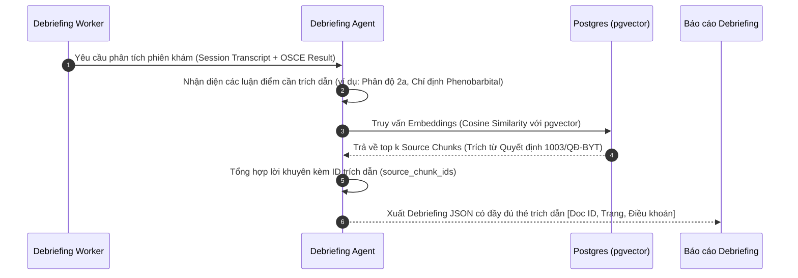

# Kiến trúc 3 Agent Nghiệp Vụ & Luồng RAG Y Tế

> **Triết lý thiết kế:** Tách bạch rõ ràng giữa **Hot Path (Thời gian thực, không nghẽn, độ trễ thấp)** cho đàm thoại lâm sàng và **Cold Path (Xử lý nền có kiểm chứng, trích dẫn y khoa)** cho chấm thi và phản hồi sau phiên khám.

---

## 1. Sơ đồ Kiến trúc Tổng thể (Architecture Overview)

```mermaid
flowchart TD
    subgraph HotPath ["HOT PATH (Thời gian thực, đàm thoại trực tiếp)"]
        Student([Sinh viên / Bác sĩ]) <-->|Voice WebM / WebSocket| API[FastAPI Gateway]
        API <--> STT[STT Adapter]
        API <--> TTS[TTS Adapter]
        API <--> PatientAgent[PATIENT AGENT\nĐóng vai Người mẹ]
        PatientAgent <--> CaseCache[(Compiled Case JSON)]
        PatientAgent --> GuardrailCheck{Hot-path Guardrails\nKiểm tra số & thuật ngữ}
    end

    subgraph ColdPath ["COLD PATH (Hậu kiểm, chạy nền qua bảng Jobs)"]
        API -->|POST /sessions/{id}/finish| JobsQueue[(Postgres Jobs Table)]
        JobsQueue --> Worker[Job Worker Loop]
        
        Worker --> EvaluatorAgent[EVALUATOR AGENT\nAuto-OSCE Analyzer]
        EvaluatorAgent --> CodeVerifier[Evidence Verifier Code\nĐối chiếu nguyên văn Turn]
        CodeVerifier --> ScoringEngine[Deterministic Scoring\nTính điểm số học theo Rubric]
        
        Worker --> DebriefAgent[DEBRIEFING AGENT\nGiảng viên Lâm sàng Ảo]
        DebriefAgent <--> RAGPipeline[RAG Engine\npgvector Cosine Search]
        RAGPipeline <--> MOHDocs[(Văn bản Hướng dẫn\nBộ Y tế QĐ 1003)]
        
        ScoringEngine & DebriefAgent --> FinalReport[(Bảng điểm & Debriefing)]
        FinalReport --> PDFEngine[PDF & QR Code Generator]
        PDFEngine --> ReportFile([Báo cáo PDF chuẩn Y khoa])
    end
```

---

## 2. Chi tiết 3 Agent Nghiệp Vụ

### 2.1. Patient Agent (Đóng vai Người mẹ bế con)
* **Mục tiêu:** Tái hiện sinh động tâm lý người mẹ lo lắng có con nhỏ bị bệnh, trả lời trung thực theo hồ sơ bệnh án, không bịa đặt triệu chứng lâm sàng.
* **Cấu trúc Prompt (Tối ưu hóa Context Caching):**
  1. *Static Prefix (Cố định 100% để cache):* Quy tắc ứng xử, văn phong tiếng Việt gần gũi, giới hạn độ dài câu nói (tối đa 2 câu ngắn).
  2. *Compiled Case Profile:* Dữ liệu ca bệnh được biên dịch từ `data/cases/*.json` gồm: Bệnh sử (`history`), Dấu hiệu khám thực thể (`exam`), Thuật ngữ cấm (`forbidden_terms` như "Enterovirus 71", "Độ 2b", "Viêm não").
  3. *Dynamic Turn History:* Lịch sử hội thoại hiện tại + bộ nhớ sự thật ứng biến (`improvised_facts`).
* **Hàng rào Bảo vệ 3 Tầng (3-Tier Guardrails):**
  * **Tier 1 (Sự thật lâm sàng):** Chỉ nói đúng những gì có trong ca bệnh.
  * **Tier 2 (Giao tiếp xã hội):** Được phép ứng biến thông tin gia cảnh, cảm xúc nhưng không chứa kiến thức y khoa mới.
  * **Tier 3 (Unknown Policy):** Với bất kỳ triệu chứng nào không được ghi nhận trong ca, mẹ bé trả lời: *"Dạ em không để ý/Dạ em không rõ bác sĩ ơi"*. Tuyệt đối không tự ý nói "cháu không bị" (tránh tạo thành triệu chứng âm tính giả).
* **Hot-path Deterministic Check:** Trước khi phát âm thanh TTS:
  * Kiểm tra mọi con số (nhiệt độ, ngày sốt, số lần giật mình) phải khớp với hồ sơ.
  * Kiểm tra không chứa từ khóa trong danh sách `forbidden_terms`.

---

### 2.2. Evaluator Agent (Chấm thi Auto-OSCE Khách quan)
* **Nguyên tắc bất di bất dịch:** **"LLM Proposes, Code Decides"** (LLM đề xuất bằng chứng, Code thuật toán quyết định điểm số).
* **Quy trình hoạt động:**
  1. Đọc toàn bộ transcript phiên khám và phiên bản Rubric OSCE (`r-01`..`r-07`).
  2. LLM trích xuất danh sách đánh giá theo JSON có cấu trúc (Structured Output):
     ```json
     {
       "criterion_id": "r-02-fever-history",
       "level": 2,
       "evidence": [
         { "turn_idx": 4, "quote": "Cháu sốt từ hôm nào và uống thuốc có hạ không chị?" }
       ],
       "feedback": "Hỏi rõ thời điểm khởi phát sốt và mức độ đáp ứng thuốc."
     }
     ```
  3. **Code Evidence Verifier:** Kiểm tra độc lập xem `turn_idx` có thực sự là lượt nói của sinh viên không, và đoạn trích `quote` có xuất hiện nguyên văn trong transcript sau khi chuẩn hóa Unicode/khoảng trắng không.
  4. **Scoring Engine:** Điểm số được tính bằng công thức toán học cố định `Sum(Weight * Score) / Sum(Weight)`.
  5. **Xử lý Dấu hiệu Nguy hiểm (Critical Red Flags):** Nếu sinh viên bỏ sót triệu chứng giật mình chới với (`r-redflag-startle`), hệ thống kích hoạt cờ `critical_missed` và hạ trần điểm tối đa.

---

### 2.3. Debriefing Agent & Khung Phản Hồi 5 Tầng
* **Mục tiêu:** Cung cấp bài học đúc kết sâu sắc về tư duy chẩn đoán và điều trị bệnh Tay chân miệng theo chuẩn sư phạm y khoa (kế thừa từ nghiên cứu CyberPatient):
  1. **Expected Approach:** Trình tự tiếp cận đúng đắn từ hỏi bệnh, phát hiện ban mụn nước, phân độ lâm sàng đến xử trí.
  2. **Rationale:** Giải thích cặn kẽ tại sao cần cảnh giác với giật mình chới với lúc thiu thiu ngủ (dấu hiệu sớm của biến chứng thân não).
  3. **Learning Points:** 3 bài học cốt lõi cần nhớ cho phân độ Tay chân miệng Độ 2a vs 2b.
  4. **Acceptable Alternatives:** Các phương án thay thế chấp nhận được (ví dụ: dùng Ibuprofen khi sốt cao không hạ với Paracetamol).
  5. **Important Errors:** Nhắc nhở các lỗi dùng thuốc sai lầm (lạm dụng kháng sinh, chỉ định corticoid khi chưa có chỉ định).

---

## 3. Luồng RAG Trích Dẫn Y Khoa (Medical RAG Pipeline)



### 3.1. Dữ liệu Nguồn RAG (Corpus Registry)
* **Văn bản pháp quy:** Quyết định số 1003/QĐ-BYT của Bộ Y tế về Hướng dẫn chẩn đoán, điều trị Bệnh Tay chân miệng.
* **Định dạng lưu trữ:**
  * Bảng `source_documents`: Lưu metadata văn bản (Tên, Số quyết định, Cơ quan ban hành, Trạng thái kiểm tra bản quyền `rights_checked: true`).
  * Bảng `source_chunks`: Lưu từng đoạn văn bản ngắn (khoảng 300 - 500 ký tự y khoa), vector embedding `vector(1536)` hoặc `vector(768)` tương thích pgvector.
* **Hợp đồng Trích dẫn (Citation Contract):**
  Mỗi khuyến nghị lâm sàng trong debriefing bắt buộc phải gắn mảng `citations`:
  ```json
  {
    "recommendation": "Trẻ có biểu hiện sốt cao trên 39°C không hạ và giật mình 1 lần khi thiu thiu ngủ, cần phân loại vào Độ 2a và cho nhập viện theo dõi.",
    "citations": [
      {
        "document_title": "Hướng dẫn chẩn đoán, điều trị bệnh Tay - Chân - Miệng",
        "decision_number": "1003/QĐ-BYT",
        "section": "Chương II: Phân độ lâm sàng - Độ 2a",
        "page_number": 4
      }
    ]
  }
  ```

