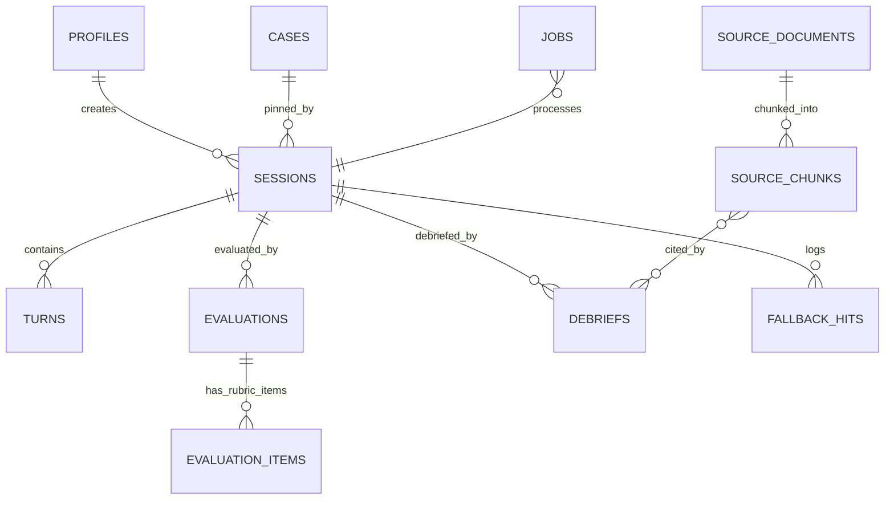

# Database: PostgreSQL on Supabase

Reference DDL: `docs/specs/schema.sql` (tested on PostgreSQL 16, see "Verified"). Alembic migrations are authoritative once AVP-007 lands.

## What Supabase is used for
| Use | Decision |
|---|---|
| Managed PostgreSQL | Yes. The only database. |
| pgvector | Yes, for RAG in the cold path (no separate vector DB). |
| Supabase Auth | Yes, for sign-in. The browser uses `supabase-js` for **auth only**. FastAPI verifies the access token (JWT). |
| Data API (PostgREST), Realtime, Storage, Edge Functions | Not used. Tables are locked against the Data API (see Security). |

## Connecting from FastAPI
Copy the connection string from the Supabase dashboard's **Connect** panel; do not assemble it by hand. URL-encode special characters in the password. Driver: SQLAlchemy 2 with **psycopg 3** (`postgresql+psycopg://...`), one driver for the async app engine and the sync Alembic engine.

| Option | Port | Use when |
|---|---|---|
| Direct connection | 5432 | Server has IPv6 (Supabase's direct host is IPv6-only unless you pay for the IPv4 add-on) |
| **Pooler, session mode** | 5432 | **Default for this project**: persistent FastAPI process, works over IPv4, supports everything including `FOR UPDATE SKIP LOCKED` |
| Pooler, transaction mode | 6543 | Only if FastAPI itself runs serverless. Then use SQLAlchemy `NullPool` and disable psycopg prepared statements (`prepare_threshold=None`); check the driver docs before relying on this. |

Rules:
- Run migrations over the same session-mode URL (`DATABASE_URL`). Do not run them through port 6543.
- Pool: small (`pool_size` about 5, `max_overflow` about 5, `pool_pre_ping=True`). Supabase's guidance is to stay near 40% of the plan's connections; check the plan's limit and the number of API workers.
- The hot path must not block on the database: load the case once per session and cache it; write turns without awaiting them before the patient audio starts; checkpoint `sessions.state` at intervals.

## Environments
| Project | Purpose | Rules |
|---|---|---|
| `avp-dev` | Daily work, throwaway data | Reset freely |
| `avp-demo` | What judges see | Migrations only with the human's OK; seed from `make load-cases`; check the plan's backup and pause policy and wake the project before demos (free-tier projects may pause when inactive) |
Never point tests at `avp-demo`. Tests that need a database use `avp-dev` or a local Postgres, with synthetic data.

## Tables & Entity-Relationship Diagram (ERD)

See `schema.sql` for columns and constraints.



| Table | Purpose | Notes |
|---|---|---|
| `profiles` | Role per Supabase user (student / instructor / admin) | `user_id` references `auth.users` |
| `cases` | Snapshot of `data/cases/*.json` | `(id, version)` key; `content_hash` change means new version; one active version per case; reviewed status needs reviewer and date |
| `sessions` | One interview | Pins `case_id` + `case_version`; `consented_at` gates research use; `user_id` null for a guest session, which carries `guest_token_hash` (exactly one of the two is set) |
| `turns` | Transcript | `t_start_ms` / `t_end_ms` give the timestamps the evaluator cites; `first_audio_ms` is the latency metric; `guardrail` records checks and regenerations |
| `evaluation_items` | One row per rubric criterion | status, level, evidence `[{turn_idx, quote}]`; checks reject met/partial without evidence |
| `evaluations` | Evaluator run | status, model, prompt/rubric/scoring versions, `total_score` computed by code; many per session allowed |
| `debriefs` | Debriefing output | Each claim lists the `source_chunks` it uses |
| `source_documents`, `source_chunks` | RAG corpus with pgvector | Ingest only when `rights_checked`; embedding dimension is fixed by the embedding model (AVP-018) |
| `jobs` | Cold-path queue | Claim with `for update skip locked`; retry with `attempts` and `run_after` |
| `fallback_hits` | Tier-3 guardrail hits | Author review backlog |

Not in the database: evaluation results used as proposal evidence. Those stay as files under `evals/results/` so they can be cited and reviewed (CLAUDE.md rule 3). Audio is not stored by default.

## Security
1. Supabase exposes tables in `public` through its Data API. A table without RLS is readable and writable by any role that holds a grant. So **every table enables RLS, has no policies, and has anon/authenticated grants revoked** (done at the end of `schema.sql`, and for every new table in its migration).
2. FastAPI reaches Postgres directly with the role in `DATABASE_URL`; RLS does not protect against bugs in FastAPI, so authorization lives there: a dependency resolves the current user from the JWT and every query on user-owned tables filters by `user_id`. A test must prove that user A cannot read user B's session, turns, evaluation, debrief or certificate.
3. A Supabase secret / service-role key bypasses RLS. FastAPI normally does not need it (it uses the database URL). If it is ever needed, it lives only in the API's environment, never in `NEXT_PUBLIC_*`, the repo or logs.
4. `make db-check-rls` must pass: no table in `public` with RLS off, and no grants to `anon` or `authenticated`:
   ```sql
   select c.relname from pg_class c join pg_namespace n on n.oid = c.relnamespace
   where n.nspname = 'public' and c.relkind = 'r' and not c.relrowsecurity;      -- expect 0 rows
   select table_name, grantee from information_schema.role_table_grants
   where table_schema = 'public' and grantee in ('anon', 'authenticated');       -- expect 0 rows
   ```
5. Verify JWTs with the project's JWKS / signing settings as described in Supabase's JWT docs (projects differ: newer ones use asymmetric keys, older ones a shared secret). Check the dashboard for which applies to `avp-dev` and `avp-demo`; task AVP-007 records the answer here.
6. Privacy: no audio stored by default; sessions deleted with the user (`on delete cascade`); provide delete-my-data before any pilot; use only consented sessions for the gold set and research.

## Migrations
- Alembic in `apps/api/alembic`, one migration per change, hand-reviewed after `--autogenerate`. Each new table's migration also enables RLS and revokes `anon`/`authenticated`.
- Naming: tables plural snake_case; ids `uuid` (`gen_random_uuid()`) except high-volume append tables that use `bigint generated always as identity`; all timestamps `timestamptz`.
- `make load-cases` is idempotent: it hashes each `data/cases/*.json`; when the hash changes it, in one transaction, sets the old version `is_active = false` and inserts the new version (the unique index allows only one active version per case). Old versions stay because sessions point to them.
- Migrations are not delegated to agy.

## Verified
`schema.sql` was run on a local PostgreSQL 16 with stubbed `auth.users`, `anon`/`authenticated` roles and `vector` replaced by `text` (no pgvector in that environment). Not yet run on Supabase itself, and the `vector` column and extension are untested: confirm in AVP-007 (re-verified after the evaluation_items change: 12 tables, RLS on all, no anon grants, evidence checks reject bad rows).
