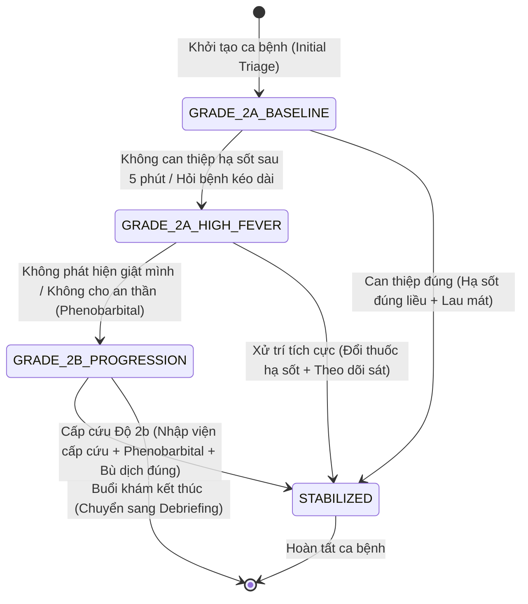

# Đặc tả Máy Trạng Thái Sinh Hiệu (Vitals State Machine)

> **Mục tiêu:** Mô phỏng diễn tiến sinh hiệu và mức độ nghiêm trọng của bệnh nhân nhi mắc Tay chân miệng (HFMD) phản ánh chân thực theo thời gian và can thiệp điều trị của sinh viên.
> 
> **Căn cứ y khoa:** Hướng dẫn chẩn đoán, điều trị bệnh Tay - Chân - Miệng ban hành kèm theo Quyết định số 1003/QĐ-BYT ngày 26/04/2012 của Bộ Y tế và cập nhật lâm sàng 2023.

---

## 1. Bảng Ma trận Giá trị Sinh hiệu theo Trạng thái (Vitals Matrix)

| Trạng thái (State) | Nhiệt độ (Temp) | Mạch (HR) | Nhịp thở (RR) | Huyết áp (BP) | SpO2 | Biểu hiện lâm sàng nổi bật |
| :--- | :--- | :--- | :--- | :--- | :--- | :--- |
| **`GRADE_1`** (Độ 1) | 37.5°C - 38.0°C | 110 - 120 l/p | 26 - 28 l/p | 90/60 mmHg | 98 - 99% | Tỉnh táo, loét vòm họng nhẹ, vài nốt sẩn ở mông/gối. |
| **`GRADE_2A_BASELINE`** (Độ 2a cơ bản - Ca mẫu) | 39.2°C | 142 l/p | 32 l/p | 95/65 mmHg | 97% | Trẻ quấy khóc nhiều, giật mình 1 lần khi thiu thiu ngủ, sốt khó hạ. |
| **`GRADE_2A_HIGH_FEVER`** (Độ 2a sốt cao kéo dài) | 39.8°C | 155 l/p | 36 l/p | 100/65 mmHg | 96% | Sốt liên tục không hạ sau paracetamol 4h, lừ đừ, quấy khóc từng cơn. |
| **`GRADE_2B_PROGRESSION`** (Độ 2b biến chứng thần kinh) | 39.5°C | 168 l/p (nhanh >150 l/p khi nằm yên) | 44 l/p | 110/70 mmHg | 94 - 95% | Giật mình chới với 2 lần trong 30 phút, run tay, mắt nhìn sững. |
| **`STABILIZED`** (Đáp ứng can thiệp) | 37.8°C | 124 l/p | 28 l/p | 92/60 mmHg | 98% | Trẻ hạ sốt, ngủ yên, nhịp tim giảm dần, hết giật mình. |

---

## 2. Sơ đồ Chuyển trạng thái (State Transition Diagram)



---

## 3. Các Sự kiện Tác động (Trigger Events)

| Mã Sự kiện (Event) | Nguồn kích hoạt | Ý nghĩa lâm sàng | Tác động chuyển trạng thái |
| :--- | :--- | :--- | :--- |
| `MEASURE_VITALS` | Sinh viên bấm đo sinh hiệu | Yêu cầu monitor cập nhật thông số | Trả về thông số hiện thời của trạng thái đang đứng. |
| `TIME_TICK` | Hệ thống (Background Timer) | Bệnh nhi không được điều trị kịp thời | Sau mỗi ngưỡng thời gian (ví dụ 3-5 phút không xử trí), sinh hiệu tự động nặng lên. |
| `ORDER_ANTIPYRETIC` | Sinh viên kê thuốc hạ sốt | Cho Paracetamol 10-15mg/kg hoặc Ibuprofen | Giúp hạ thân nhiệt từ từ, giảm nhịp tim (mỗi 1°C giảm tương đương giảm ~10 nhịp tim). |
| `ORDER_SEDATIVE` | Sinh viên chỉ định thuốc | Chỉ định Phenobarbital uống/tiêm khi có giật mình | Cắt cơn giật mình chới với, ngăn tiến triển lên Độ 2b/Độ 3. |
| `ORDER_INCORRECT` | Sinh viên kê đơn sai | Kê kháng sinh không cần thiết, corticoid liều cao | Trừ điểm Auto-OSCE (Overuse/Contraindication penalty), không cải thiện sinh hiệu. |

---

## 4. Contract Schema (Dữ liệu State Machine trong Backend)

```typescript
export interface VitalsSnapshot {
  temperature_c: number;
  heart_rate_bpm: number;
  respiratory_rate_bpm: number;
  blood_pressure_sys: number;
  blood_pressure_dia: number;
  spo2_percent: number;
  clinical_state: "GRADE_1" | "GRADE_2A_BASELINE" | "GRADE_2A_HIGH_FEVER" | "GRADE_2B_PROGRESSION" | "STABILIZED";
  updated_at: string;
  active_symptoms: string[];
}

export interface VitalsEventPayload {
  event: "MEASURE_VITALS" | "ORDER_MEDICATION" | "ORDER_PROCEDURE" | "TIME_TICK";
  details?: {
    medication_name?: string;
    dosage_mg_kg?: number;
    route?: string;
  };
}
```

